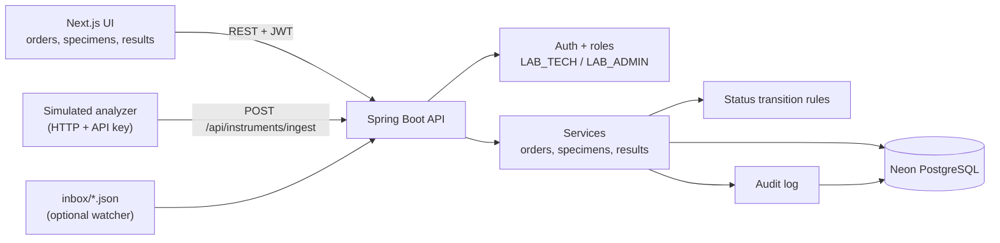

# Specimen Management System

[](https://github.com/Bkumar-007/specimen-management-system/actions/workflows/ci.yml)

Portfolio lab workflow app: **order → accession → status tracking → results**, with audit logging and a **simulated instrument (analyzer) interface**.

> Fictional demo data only. Not affiliated with STARLIMS, Outreach, or any commercial LIMS.

## Stack

- Backend: Java 21, Spring Boot 3, Spring Security (JWT), JPA, Flyway
- Frontend: Next.js (JavaScript, App Router)
- Database: [Neon](https://neon.tech) free-tier Postgres (H2 in-memory for automated tests)
- Ops: Docker / Compose, GitHub Actions CI

## Architecture



Layers (`backend/src/main/java/com/specimen/sms`): `domain` (entities, repositories), `application` (services, status rules, instrument ingest), `web` (controllers, DTOs, error handler), `security`, `config`.

## Prerequisites

- Java 21, Maven 3.9+
- Node.js 20+
- A Neon project and a root `.env` (see `.env.example` and [docs/NEON_SETUP.md](./docs/NEON_SETUP.md))

## Run locally

1. Copy `.env.example` to `.env` and fill in the Neon values.
2. Backend (port 8080):

   ```bash
   cd backend
   mvn spring-boot:run
   ```

   Health check: `http://localhost:8080/api/health`. Flyway applies schema migrations on startup; catalog, clients and demo users are seeded when empty.

3. Frontend (port 3000):

   ```bash
   cd frontend
   npm install
   npm run dev
   ```

   Open `http://localhost:3000`.

### Docker Compose (API + local Postgres)

No Neon required for an offline demo:

```bash
docker compose up --build
```

API: `http://localhost:8080`. Optional UI container: `docker compose --profile full up --build` (port 3000).

### Seed users

| Username | Password   | Role      |
|----------|------------|-----------|
| `admin`  | `admin123` | LAB_ADMIN |
| `tech`   | `tech123`  | LAB_TECH  |

Set `SEED_DEMO_USERS=false` to skip creating these (do this for any shared deployment).

### Tests

```bash
cd backend
mvn test
```

Covers the status transition rules, the full order-to-reported workflow over HTTP (including role checks and audit), and both instrument interfaces. Tests use in-memory H2, so they do not touch Neon.

## Roles

| Role        | Can do |
|-------------|--------|
| `LAB_TECH`  | Create orders, accession specimens, move status forward, enter results, search, view a specimen timeline |
| `LAB_ADMIN` | Everything a tech can, plus cancel/reject (reason required), manage clients/tests, view the audit trail, override the results requirement for REPORTED |

## Status rules

```text
COLLECTED → RECEIVED → IN_TESTING → RESULTED → REPORTED      (no skipping, no going back)
any non-final state → CANCELLED | REJECTED                   (admin only, reason required)
```

- Results can only be entered from `RECEIVED` or `IN_TESTING`; saving results moves the specimen to `RESULTED`.
- `REPORTED` requires at least one result. A lab admin may override with `{"override": true, "reason": "..."}` from `RECEIVED`/`IN_TESTING`.
- `CANCELLED`, `REJECTED` and `REPORTED` are final.
- An order's status is derived from its specimens (`ORDERED` until one is accessioned).
- Concurrent status/result updates use optimistic locking (`version`); a stale update returns HTTP **409**.

## API

All endpoints except login, health and instrument ingest need `Authorization: Bearer <token>`. Errors are JSON: `{"status":409,"message":"...","fieldErrors":{...}}`.

| Method | Path | Notes |
|--------|------|-------|
| POST | `/api/auth/login` | `{username, password}` → `{token, username, role}` |
| GET / POST | `/api/clients` | POST admin only |
| GET / POST | `/api/tests` | test catalog; POST admin only |
| GET / POST | `/api/orders` | GET `?q=` (order no., MRN, name) `&status=`; POST `{clientId, testIds[], patient{mrn, firstName, lastName, dateOfBirth, sex}}` |
| GET | `/api/orders/{id}` | order detail with specimens |
| POST | `/api/orders/{id}/specimens` | accession: `{tubeType, collectedAt?, markReceived?}` → barcode generated |
| GET | `/api/specimens` | Paginated: `?barcode=&patient=&status=&from=&to=&needsAction=&page=&size=` → `{content, page, size, totalElements, totalPages}` |
| GET | `/api/specimens/{id}` | detail incl. results and allowed next statuses |
| GET | `/api/specimens/{id}/timeline` | audit entries for the specimen |
| PATCH | `/api/specimens/{id}/status` | `{status, version, reason?, override?}` |
| POST | `/api/specimens/{id}/results` | `{version, results:[{analyte, value, unit?, flagged?}]}` |
| GET | `/api/audit` | `?entityType=&entityId=`, admin only |
| GET | `/api/stats` | specimen counts by status |
| POST | `/api/instruments/ingest` | analyzer message; JWT **or** `X-Instrument-Key` header |

## Lab instrument interface (simulated analyzer)

A simulated analyzer posts JSON keyed by specimen barcode. The service matches the barcode, attaches the results (attributed to `instrument:<id>` in the audit log) and moves the specimen to `RESULTED`. The specimen must be `RECEIVED` or `IN_TESTING`.

```bash
curl -X POST http://localhost:8080/api/instruments/ingest \
  -H "Content-Type: application/json" \
  -H "X-Instrument-Key: sim-analyzer-key" \
  -d @docs/samples/analyzer-message.json
```

(Edit `barcode` in the sample first.) Flags `H`, `L`, `HH`, `LL`, `A` mark a result abnormal; `N` does not. The same message format can be tried from the **Instrument** page in the UI.

**File drop (optional):** start the backend with `INSTRUMENT_INBOX_ENABLED=true`, then copy a `.json` message into `backend/inbox/`. Processed files move to `inbox/processed/`, rejects to `inbox/failed/` with a `.error.txt` explaining why. Change the key with `INSTRUMENT_INBOX_DIR` / `INSTRUMENT_API_KEY`.

The message is a simple JSON format designed for this project. It is not HL7 or ASTM.

## Demo script (happy path)

1. Sign in as `tech` / `tech123`. Land on the **Work queue** (actionable specimens by status).
2. **Orders → New order**: pick a client, enter a fictional patient (see [docs/SAMPLE_DATA.md](./docs/SAMPLE_DATA.md)), tick CBC, create.
3. On the order page, **Accession** the specimen. Print the accession label preview if you want; barcode status is `RECEIVED`.
4. Press `/` and paste the barcode into the top **Scan** box → opens the specimen. Click **Move to IN TESTING**.
5. Enter results (for example WBC 11.9, flag abnormal) and save, or send the sample on the **Instrument** page. Status becomes `RESULTED`.
6. From the work queue (or specimen page) **Report**. Timeline shows each step and who did it.
7. **Specimens**: filter by status, date range, MRN, or barcode (paginated).
8. Sign in as `admin` / `admin123` for **Audit**, or reject another specimen with a reason.

## Deploying (optional)

**Step-by-step (Render + Netlify + Neon):** see [docs/DEPLOY.md](./docs/DEPLOY.md).

- **Backend** (Render Docker, Railway, Azure, etc.): use `backend/Dockerfile`, or `mvn -DskipTests package` then `java -jar target/specimen-management-0.0.1-SNAPSHOT.jar`. Set `DB_URL`, `DB_USERNAME`, `DB_PASSWORD`, `JWT_SECRET`, `INSTRUMENT_API_KEY`, `CORS_ALLOWED_ORIGINS`, and `SEED_DEMO_USERS`.
- **Frontend** (Netlify): set `NEXT_PUBLIC_API_URL` to the backend URL, then build. See `netlify.toml`.
- Neon and free Render both sleep when idle — first request after a pause can take ~30–60s.
- Schema is managed with Flyway (`backend/src/main/resources/db/migration`); Hibernate runs in `validate` mode.

## Docs

- [PROJECT_PLAN.md](./PROJECT_PLAN.md): vision, domain model, and build phases
- [docs/NEON_SETUP.md](./docs/NEON_SETUP.md): create the Neon database
- [docs/SAMPLE_DATA.md](./docs/SAMPLE_DATA.md): fictional demo data
- [docs/LEARNING_LOG.md](./docs/LEARNING_LOG.md): short decisions per phase

## Status

Phases 0 through 5 are implemented. See the checklist in `PROJECT_PLAN.md`.
